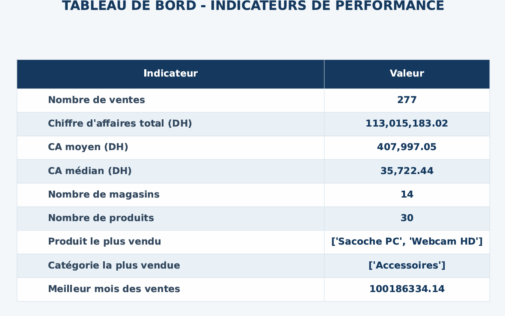

# Sales Data Pipeline

A Python and Jupyter project for validating, cleaning, transforming, and analyzing retail sales data. The pipeline combines sales, product, and store records to calculate revenue and generate reports and visualizations.

## What it does

- Checks that each CSV has the expected columns.
- Cleans sales, product, and store data, separating accepted rows from rejected rows.
- Enriches sales with product names, categories, and store cities.
- Calculates revenue as `quantite * prix_unitaire`.
- Summarizes revenue by month, city, product, and category.
- Exports KPI and revenue reports as PDFs, along with chart images.

## Project structure

```text
Sales-Data-Pipeline/
├── Data/
│   ├── ventes.csv
│   ├── produits.csv
│   └── magasins.csv
├── Screenshots/
│   ├── KPI.png
│   └── Ventes Visualisation.png
├── Main.ipynb
├── analyse.ipynb
└── Requirements.txt
```

## Input data

Place the three input CSV files in `Data/`. The expected columns are:

| File | Required columns |
|---|---|
| `ventes.csv` | `vente_id`, `date`, `produit_id`, `magasin_id`, `quantite`, `prix_unitaire` |
| `produits.csv` | `produit_id`, `nom_produit`, `categorie` |
| `magasins.csv` | `magasin_id`, `ville` |

## Getting started

Use Python 3. Install the project dependencies:

```bash
python -m pip install pandas numpy matplotlib seaborn jupyter ipykernel
```

Launch the main notebook from the project directory:

```bash
jupyter notebook Main.ipynb
```

Run the notebook's code cell. When prompted, provide the paths to the sales, products, and stores CSV files, for example:

```text
Data/ventes.csv
Data/produits.csv
Data/magasins.csv
```

The notebook checks the input schemas before starting the pipeline. Choose `n` when prompted to finish, or `y` to process another set of files.

## Generated files

Each run creates a timestamped folder under `Exports/`:

```text
Exports/
└── pipeline_YYYYMMDD_HHMMSS/
    ├── Cleaned Files/
    ├── Rejected Files/
    └── Rapports/
        ├── CA Details.pdf
        ├── Rapport KPI.pdf
        └── Visualisation/
```

The cleaned and rejected CSVs are separated by input table. Reports include KPI and revenue summaries, and visualizations include revenue breakdowns by month, city, category, and product.

## Screenshots


